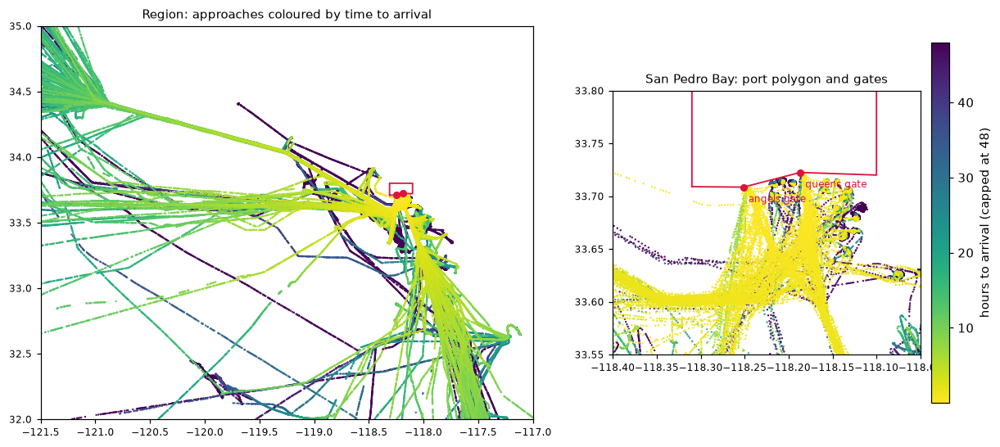
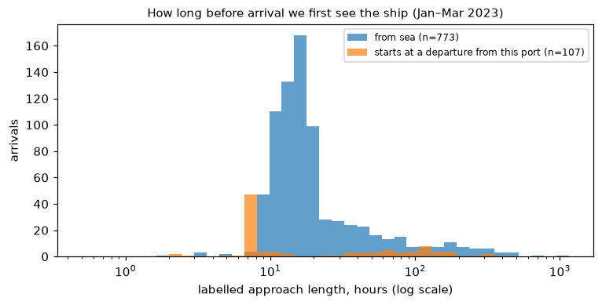
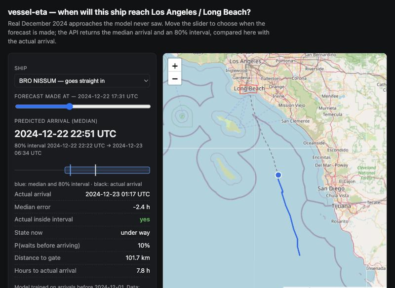

# vessel-eta — when will this ship reach Los Angeles?

[](https://github.com/Vladimir-Aristov/vessel-eta/actions/workflows/ci.yml)
[](LICENSE)

Probabilistic ETA for cargo ships and tankers approaching the ports of **Los Angeles and
Long Beach**, built end to end from raw NOAA AIS transponder data: 6.1 billion raw rows →
378M clean positions (2023–24) → 7,937 port arrivals → a model that says not just *when*
but *how sure*: "2 h if it goes straight in, 1–4 days if it queues".

**Results at a glance** — trained on 2023, tested on every arrival of 2024 (4,193 voyages):

| | distance / speed | calibrated physics | single LightGBM | **this model** |
|---|---|---|---|---|
| MAE, all predictions | 85.8 h | 76.4 h | 72.9 h | **70.5 h** |
| MAE, ships under way far out | 21.5 h | 22.5 h | 19.1 h | **17.7 h** |
| MAE, ships at anchor | 138.5 h | 119.6 h | 116.5 h | **112.9 h** |
| 80% interval actually holds | — | 0.78 | — | **0.79** (0.80 under way) |

**What is in here**

- **Data engineering**: resumable parallel downloader and streaming ingest for two NOAA
  formats (zipped CSV, GeoParquet); malformed rows, duplicate and junk MMSIs handled and
  counted ([Data](#data)).
- **Messy-data detective work**: one MMSI is not always one ship — position spikes, "ghost"
  positions and stale messages replayed hours later, separated by physical consistency
  ([Tracks](#1-one-mmsi-is-not-always-one-ship)).
- **Label design**: a breakwater geofence validated against the data, arrivals, and a
  leak that made a feature encode the dataset's start date — caught and fixed.
- **Validation that does not flatter**: time split + held-out ships, causal features with
  a look-ahead test that is itself mutation-tested, slices you can see at prediction time.
- **Modelling the real structure**: ETA = travel + will it queue + how long, quantile
  LightGBMs + classifier, conformal intervals ([Decomposed ETA](#decomposed-eta-with-intervals)).
- **Negative results, reported**: public port-queue data (IMF PortWatch, Port of LA) and a
  GRU over the raw track did not beat the simpler model ([GRU](#does-a-sequence-model-help-gru-for-travel-time)).
- **Out-of-time test and drift**: a year later the model holds up but its intervals go
  stale; monthly re-calibration fixes it ([2024](#out-of-time-test-train-2023-test-2024)).
- **Serving**: FastAPI service (~9 ms per request) using the training feature code — no
  train/serve skew, checked by a test — gzipped text artifact, re-calibration command,
  Docker image built and smoke-tested in CI, and a map demo ([Serving](#serving-api-docker-demo)).



## Why this problem

Every ship over 300 GT broadcasts its position, speed and heading over AIS every few seconds.
NOAA archives these broadcasts for all US waters: billions of points per year, free (CC0).

- **ETA prediction** is a real product problem (ports, terminals, logistics, insurers)
  with labels that come for free: the moment a ship actually arrived is in the data.
- **Behavioural anomalies** (planned) — transponders switched off, ships loitering or
  meeting at sea, a declared vessel type that does not match how the ship moves.

The first region is the approaches to **Los Angeles / Long Beach**, the busiest container
port complex in the US.

## Data

| Years     | Source                         | Raw format                   | Size / day |
|-----------|--------------------------------|------------------------------|------------|
| 2015–2023 | `coast.noaa.gov` AISDataHandler | zipped CSV                   | ~320 MB zip / ~900 MB CSV |
| 2024      | MarineCadastre Azure blob      | GeoParquet (WKB points)      | ~230 MB    |

Both formats are normalised into one schema and written as daily Hive partitions:

```
data/interim/ais/date=2023-01-01/part-0.parquet   # one region, one day, zstd
data/interim/ais/_manifest.jsonl                  # row counts and drop reasons per day
```

| column | type | notes |
|---|---|---|
| `mmsi` | int32 | ship identity (only ship stations, first digit 2–7) |
| `ts` | datetime[ms, UTC] | |
| `lat`, `lon` | float64 | WGS84 |
| `sog`, `cog` | float32 | knots, degrees; AIS "not available" sentinels → null |
| `heading` | int16 | 511 → null |
| `vessel_name`, `imo`, `call_sign` | str | empty → null |
| `vessel_type`, `status`, `cargo` | int16 | AIS codes |
| `length`, `width`, `draft` | float32 | metres; 0 → null |
| `transceiver` | str | class A / B |

Cleaning rules (from ITU-R M.1371) and the reasons for every dropped row are in
[`ingest.py`](src/vessel_eta/data/ingest.py) and logged per day in the manifest.

### Pipeline design notes

- **Streams the CSV out of the zip** in 16 MB blocks and clips to the region per block,
  so a day never touches disk uncompressed. One day (8M rows, ~900 MB of CSV) is
  processed in ~4 s at ~1.3 GB peak memory, and the range length does not change that.
- **Resumable parallel downloads**: `.part` files + HTTP Range, size checked against
  `Content-Length` before the atomic rename, exponential backoff on 5xx/timeouts only.
- **Idempotent**: re-running a command skips finished days; interrupted runs continue.
- `fetch` deletes raw files after each batch, so a year of data needs about
  `concurrency × 320 MB` of scratch disk instead of ~115 GB. One region-day is ~3.5 MB.

## From points to ETA labels

`uv run vessel-eta labels` turns the clean points of cargo ships and tankers
(AIS types 70–89) into voyages and labelled approach points:

```
data/processed/voyages_la_lb.parquet      # one row per port arrival
data/processed/eta_points_la_lb.parquet   # approach points with eta_min (the target)
data/processed/labels_la_lb.json          # summary below
```

### 1. One MMSI is not always one ship

Even after row-level cleaning, 294 of the 418 cargo/tanker MMSIs seen in January had
at least one position jump no ship could make. Looking at the rows, three different causes:

| what | example | how it is caught |
|---|---|---|
| single-point spike | POLARIS VOYAGER reported 110+ km off its track for one minute | faster than 40 kn |
| ghost positions | SYNERGY KEELUNG "stationary inside the port" every few minutes while steaming at sea | faster than 40 kn |
| stale message re-received hours later | an anchored ship "jumps" 3 km to where it was 6 h earlier, then back | implied speed > reported SOG + 10 kn |

[`tracks.py`](src/vessel_eta/tracks.py) assigns each point, in time order, to the
longest sub-track it could physically have come from, and keeps only the main one.
Over Jan–Mar it drops 0.9% of points (7,434 spikes + 32,109 ghost/replay points;
ghosts on 370 of 836 ships). The third
case was only found because an early version produced a ship that "arrived" in
port twice in five hours without ever leaving.

### 2. What "arrived" means — the port geofence

Arrival = passing the breakwater through Angels Gate or Queens Gate. Ships waiting
at the outer anchorages have not arrived; ships moved to the inner anchorages have.
The polygon ([`configs/port.yaml`](configs/port.yaml)) follows the breakwater and was
checked against the data (Jan–Mar 2023, cleaned tracks) rather than drawn by eye:

- 99.999% of moored cargo positions (AIS status 5) fall inside;
- no anchorage swing circle is cut by the edge: of 848 at-anchor stays, the 6 with points
  on both sides are ships moved between an outer and an inner anchorage without changing
  their AIS status (two clusters 1.4–9.3 km apart, one after the other);
- labelled arrivals are first seen inside a median 0.27 km (p99 1.2 km) from a gate.

### 3. Voyages and labels

[`voyages.py`](src/vessel_eta/voyages.py), per ship:

- inside-port visits shorter than 10 min are boundary jitter, not arrivals;
- the approach before an arrival is cut at the last silence longer than 6 h, so a ship
  that passed by on day 3 and called on day 25 does not get a 22-day "ETA";
- if the ship is silent for more than 15 min right at the entrance, the arrival time
  is unsure: the voyage is kept but not labelled (90 of 970 arrivals);
- passing traffic and ships still at sea when the data ends get no labels.

| Jan–Mar 2023 | |
|---|---|
| arrivals detected | 970 |
| labelled arrivals (623 cargo, 257 tanker) | 880 |
| — approach starts at a departure from this port (berth shift, anchoring trip) | 107 |
| ships | 597 |
| labelled points | 1,134,014 (53% within 24 h of arrival) |
| approach length, median / p90 | 16.0 h / 81 h |

`from_port` is true only when the labelled approach begins at the port exit. An earlier
version set it whenever the ship had *any* earlier port stay in the data, so liner ships
returning from Hawaii a week later counted as "from port" — and the share grew with the
length of the data window (17% in January, 52% in March): a feature that would have
leaked the dataset's start date into the model.



The orange spike at ~7.5 h is almost entirely one ship: CATALINA PROVIDER, the
Santa Catalina Island supply vessel, with 51 of the 880 labelled arrivals. Its labels are
correct, but a model scored on random rows would look better than it is by learning one
easy, repetitive route — so validation must split by vessel, and metrics are reported
per voyage as well as per point.

The long tail is waiting: 102 labelled voyages spend more than half their approach
stationary at the outer anchorages. Predicting *that* wait is the hard part of ETA.

**The bar to beat.** Straight-line distance to the nearest gate divided by current
speed, on underway points (SOG > 5 kn) within 24 h of arrival (445k points):
**MAE 151 min**, and it is biased — the median prediction is 92 min too early (ships slow down for the pilot
and follow the traffic lanes, not a straight line).

## First model and what it tells us

*This section and the next were done on Jan–Mar 2023 (train Jan–Feb, test March).*

`uv run vessel-eta train` → [`reports/eta_v1.md`](reports/eta_v1.md).

**Features** ([`features.py`](src/vessel_eta/features.py)): distance and bearing to the
gates, speed/course now and over the last 30 min–6 h, closing speed over the last hour,
time spent stationary so far, ship size/draft, hour and weekday, and port-wide counts
(ships waiting at anchor, inbound, in port) from the previous 30 minutes. Every feature
uses only data up to the prediction time; `tests/test_features.py` truncates tracks at 71
cut-offs and checks nothing changes. Two deliberate leaks (time measured from the
voyage's *end*; port state from the *current* half hour) were planted to make sure the
test catches them — the second was only caught after the cut-offs were made dense.

**Validation**: train on arrivals in Jan–Feb, test on March; early stopping on 20% of
*ships* held out from training; configuration chosen by 5-fold CV grouped by ship on
Jan–Feb ([`reports/cv_ablation.md`](reports/cv_ablation.md)); March scored once. One row
per 5 minutes per voyage (neighbouring minutes are near-duplicates, and the effective
sample is ~500 voyages, not 200k rows — hence small, heavily regularised trees).

**Test, March 2023** — 310 voyages; absolute error in hours:

| model | point MAE | median AE | voyage MAE | median bias |
|---|---|---|---|---|
| constant median | 103.9 | 26.0 | 27.1 | -18.5 |
| distance / speed | 97.1 | 33.8 | 16.1 | -28.0 |
| calibrated distance / speed | 93.3 | 34.3 | 19.7 | -0.6 |
| LightGBM | 99.4 | 27.8 | 16.0 | -13.1 |

By what you can see when predicting (MAE, hours):

| ship state | rows | median true ETA | distance / speed | calibrated | LightGBM |
|---|---|---|---|---|---|
| moving, < 30 km from gate | 9,219 | 1.6 | 12.5 | 13.6 | **11.9** |
| moving, ≥ 30 km | 38,134 | 11.6 | 28.8 | 28.7 | **26.8** |
| slow (0.5–5 kn) | 26,772 | 94.2 | 75.1 | **74.6** | 85.7 |
| stationary | 77,858 | 75.1 | 148.2 | **140.8** | 150.1 |

What this says:

1. **The model does not beat simple physics overall.** It wins on moving ships (5–7%),
   loses to a two-parameter calibration on ships that are slow or at anchor, and ties
   distance/speed per voyage. CV on Jan–Feb tells the same story, so this is not bad luck
   with March.
2. **The error is the queue, not the voyage.** Even moving ships within 30 km of the gate,
   whose median true ETA is 1.6 h, have a ~12 h MAE: some of them are heading for an
   anchorage and will wait for days. Whether a ship goes straight to a berth is decided by
   berth schedules that are not in AIS. "Distance/speed is off by only 0.5 h when the true
   ETA is under 2 h" is a selection effect — that slice contains only ships that went
   straight in (see the true-horizon table in the report).
3. **Unseen ships are much harder** (voyage MAE 19.6 h vs 11.6 h for ships seen in
   training), and all models under-predict them: March's new arrivals waited longer than
   anything in Jan–Feb.
4. Ship size and draft matter (removing them hurts in CV), and the strongest features are
   the physical ones: closing speed, current speed, distance/speed.

So the next model should not be a bigger regressor over the same mixture, but a
decomposition: *travel time to the next stop* (predictable from motion) + *will it anchor
first* (classifier) + *how long it waits* (survival-style, with port congestion), with
quantile outputs so the answer can be "2 h if it goes in, 1–4 days if it queues".

## Decomposed ETA with intervals

`uv run vessel-eta train --version v2` → [`reports/eta_v2.md`](reports/eta_v2.md);
code in [`decompose.py`](src/vessel_eta/decompose.py).

v1 said the error is the queue, so v2 models the queue explicitly:

```
ship under way:  ETA = T + B·W     T  time to the next event (waiting starts, or arrival)  quantile LightGBM
                                   B  will it wait before arriving?                       classifier
                                   W  from the start of that wait to arrival               quantile LightGBM
ship waiting:    ETA = A           A  remaining time to arrival                           quantile LightGBM
```

- **Waiting** is not only anchoring: of approach points more than 3 days out, 53% are at
  anchor ~15 km from the gate, ~27% drift or crawl at 0.5–3 kn 70–80 km offshore, and
  some are moored at other ports in the region. An *episode* is a run where the centred
  30-min median SOG stays under 2 kn for ≥1 h, merged across gaps < 6 h, kept if ≥2 h:
  344 episodes on 287 of 880 voyages, median 27 h, p90 147 h.
- **Which branch answers** is decided from what is visible now (mean SOG over the last
  30 min < 2 kn), never from the labels.
- The ETA **distribution** of a moving ship is the mixture of T, B and W, built by
  sampling (7 quantiles per model); the point forecast is its median.
- **Conformal step (CQR):** the raw quantiles under-covered even inside Jan–Feb (76% for a
  nominal 80%, mostly above P90). P10/P90 are widened in log space per branch so that 10%
  of outcomes fall on each side on held-out *ships* of the training period. Grouped CV:
  76.5% → 78.9% ([`reports/cv_v2_coverage.md`](reports/cv_v2_coverage.md)).

**Test, March 2023** (same split and baselines as v1; hours):

| ship state | distance / speed | v1 | v2 | v2 P10–P90 coverage / median width | baseline* coverage / width |
|---|---|---|---|---|---|
| moving, < 30 km from gate | 12.5 | 11.9 | **11.2** | **0.83** / 18 h | 0.47 / 18 h |
| moving, ≥ 30 km | 28.8 | 26.8 | **24.7** | **0.79** / 40 h | 0.86 / 66 h |
| slow (0.5–5 kn) | 75.1 | 85.7 | 77.0 | 0.88 / 277 h | 0.82 / 257 h |
| stationary | 148.2 | 150.1 | 143.1 | 0.71 / 277 h | 0.79 / 430 h |
| **all points** (MAE / coverage) | 97.1 | 99.4 | 93.7 | 0.77 | 0.79 |

\* calibrated distance/speed × empirical quantiles of its training residuals, per branch.

- **Ships under way** — the case an ETA is for — get the best point forecast (−10% / −14%
  vs distance/speed near / far) and intervals that mean what they say. The baseline's
  "80%" interval near the port holds 47% of outcomes at the same width.
- **Will it wait?** AUC 0.85, Brier 0.142 vs 0.245 for the base rate. In March, 37% of
  moving-ship rows were followed by a wait against 25% in Jan–Feb, and the classifier
  under-predicts at every level (e.g. says 0.72, observed 0.88): the share of ships
  queueing rose, and nothing in the features fully explains why.
- **Waiting time** remains the weak part: for ships at anchor the median forecast is no
  better than a two-parameter calibration, and coverage drops to 71% in March because
  waits there ran longer than anything in the training months. The median of v2 is
  nearly unbiased overall (−1.3 h vs −13 h for v1).

What would move the needle next is not model capacity but information AIS does not
carry: berth schedules and vessel line-ups (published by the ports), and a longer history
so that a month like March is not out of distribution.

## A full year, and does public queue data help?

**More data.** All of 2023 was downloaded (365 days, 3.03 billion rows for US waters,
187M clean rows in the region; 11 malformed CSV rows over the year are skipped and
counted). Labels: 3,744 arrivals on 1,520 ships, 4.6M labelled points; monthly shares of
waiting and returns-from-port are stable (8–13% and 10–13%).

**Queue data.** The obvious missing input is the queue itself. What exists publicly:

| source | what | used as |
|---|---|---|
| own AIS | ships waiting near the port, 24 h and 7 d means, today vs the week | `port_waiting_24h/7d/trend` |
| [IMF PortWatch](https://portwatch.imf.org) | daily port calls by type and estimated import/export tonnes for LA–LB (`port664`) | 7-day sums, **lagged 8 days** (published weekly) |
| [Port of LA](https://portoflosangeles.org/business/supply-chain/ships) yearly PDF | per business day: POLA container ships at anchor / at berth, days at anchor for departed ships | last report and 5-report means, from the next day |
| Marine Exchange of Southern California | the official queue and line-up | not used: paid, no redistribution |

The Port of LA summary has one surprise: in 2023 POLA container ships waited at anchor
for **about 2 hours on average** (0 ships at anchor on 159 of 246 days). The 2021–22 queue
was gone, so the multi-day waits in this data are mostly tankers, bulkers and Long Beach
calls — which that summary does not cover.

**Results** — the same test set throughout: arrivals Oct–Dec 2023, 954 voyages; hours.

| model | trained on | point MAE | voyage MAE | P10–P90 coverage | pinball |
|---|---|---|---|---|---|
| distance / speed | — | 66.1 | 12.6 | | |
| calibrated distance / speed | Jan–Sep | 57.3 | 15.5 | 0.81 | 20.1 |
| v1 (single LightGBM) | Jan–Sep | 52.0 | 11.9 | | |
| v2, base features | Jan–**Mar** | 54.5 | 13.5 | 0.86 | 24.9 |
| **v2, base features** | Jan–Sep | **50.7** | **11.4** | **0.80** | **17.3** |
| v2, + AIS queue + PortWatch | Jan–Sep | 51.1 | 11.3 | 0.80 | 17.4 |
| v2, + Port of LA summary | Jan–Sep | 51.1 | 11.4 | 0.80 | 17.5 |

By ship state (v2 base, Jan–Sep; MAE in hours, then P10–P90 coverage / median width):

| ship state | distance / speed | calibrated | v1 | v2 | v2 interval | baseline interval |
|---|---|---|---|---|---|---|
| moving, < 30 km from gate | 13.5 | 14.1 | 13.2 | **13.0** | 0.82 / 25 h | 0.46 / 16 h |
| moving, ≥ 30 km | 17.6 | 19.5 | 16.1 | **15.0** | 0.76 / 21 h | 0.90 / 78 h |
| slow (0.5–5 kn) | 81.9 | 80.3 | **69.3** | 69.9 | 0.80 / 194 h | 0.67 / 206 h |
| stationary | 107.6 | 88.5 | 81.9 | **80.0** | 0.83 / 237 h | 0.81 / 273 h |

What this says:

1. **More history was the lever, not more sources.** On the same Oct–Dec test, going
   from 3 to 9 months of training cut voyage MAE by 16% and pinball loss by 31%, put
   interval coverage on target, and turned v2 from worse-than-physics per voyage (13.5 vs
   12.6) into better (11.4). Waiting time — hopeless on three months — is now predicted
   better than the calibrated baseline (80 vs 89 h at anchor).
2. **Public queue data added nothing measurable** (±0.4 h, within noise). PortWatch is
   itself built from AIS and arrives a week late; the Port of LA summary covers container
   ships that barely queued in 2023. What the model already sees — ships waiting near the
   port right now, from its own AIS — carries the same information sooner.
3. **The test period matters as much as the model.** v2 trained on Jan–Feb scored 93.7 h
   MAE on March; trained on Jan–Mar it scores 54.5 h on Oct–Dec: late 2023 had fewer and
   shorter queues (22% of moving
   ships went on to wait vs 37% in March). Numbers from different test windows are not
   comparable, which is why every row above uses the same one.

Reproduce: `uv run vessel-eta portwatch`, save the Port of LA PDF to `data/external/`, then
`uv run vessel-eta train --version v2 --test-start 2023-10-01 --features base|queue|all`
(add `--train-end 2023-04-01` for the 3-month row). Reports: `reports/eta_v2_2023_*.md`.

## Does a sequence model help? (GRU for travel time)

PyTorch is an optional extra: `uv sync --extra nn` (CI and the rest of the project don't need it).

[`sequence.py`](src/vessel_eta/sequence.py), [`scripts/travel_models.py`](scripts/travel_models.py)
→ [`reports/travel_models.md`](reports/travel_models.md).

The travel part T (time to the next event for a ship under way) is where motion matters
most, so it is the natural place for a model that reads the raw track instead of
hand-made summaries. The GRU sees the last 2 hours of the voyage on the 5-minute grid
(position relative to the port, speed, course, stopped or not, time gaps), joined with
the same tabular features LightGBM uses; it outputs the same 7 monotone quantiles and is
trained with pinball loss on PyTorch/MPS, with early stopping on held-out ships. A
tabular-only MLP with the identical head isolates what the sequence itself adds.

Test: ships under way, arrivals Oct–Dec 2023 (180k rows); every choice made on
held-out ships of Jan–Sep, test scored once.

| model for T | pinball (log) | MAE | median AE | P10–P90 coverage |
|---|---|---|---|---|
| LightGBM, tabular | 0.084 | 1.08 h | 0.43 h | 0.79 |
| MLP, same tabular inputs | 0.097 | 1.27 h | 0.50 h | 0.76 |
| GRU over 2 h of track + tabular | 0.094 | 1.26 h | 0.50 h | 0.78 |
| GRU, + dropout / weight decay | 0.116 | 1.41 h | 0.66 h | 0.94 |
| 0.75 × LightGBM + 0.25 × GRU (weight chosen on valid) | **0.083** | **1.08 h** | **0.41 h** | **0.82** |

- **The track carries signal** that the tabular features miss: on identical inputs and
  head, adding the GRU branch improves pinball by ~3–6% over the MLP.
- **But gradient boosting on good features stays ahead** of both networks, as is usual for
  tabular problems of this size (~400k training rows, highly correlated within voyages).
  The GRU starts to overfit after 4–5 epochs; stronger regularisation made it worse.
- **The ensemble wins, barely**: −0.3% pinball, −4% median error, coverage closer to 0.8.
  Not worth a second model and a PyTorch dependency in serving, so v2 keeps LightGBM for T.
  (Neural results move by a few % between runs: MPS training is not bit-reproducible.)

## Out-of-time test: train 2023, test 2024

The strictest check available: the model is fitted on 2023 only and scored on every
arrival of 2024 (4,193 voyages, 1,697 ships) — a year it has never seen, with its own
seasons and queues. 2024 is GeoParquet from a different NOAA feed; the same pipeline reads
it. Hours; [`reports/eta_v2_2024_base.md`](reports/eta_v2_2024_base.md).

| ship state | distance / speed | calibrated | v1 | **v2** |
|---|---|---|---|---|
| moving, < 30 km from gate | 15.8 | 16.3 | 16.5 | **14.1** |
| moving, ≥ 30 km | 21.5 | 22.5 | 19.1 | **17.7** |
| slow (0.5–5 kn) | 86.0 | 82.4 | **74.3** | **74.3** |
| stationary | 138.5 | 119.6 | 116.5 | **112.9** |
| **all points** (MAE / voyage MAE) | 85.8 / 13.4 | 76.4 / 15.8 | 72.9 / 15.2 | **70.5 / 12.7** |

- v2 holds up a year later: best or tied in every state, median bias −0.2 h. Ships it never
  saw in 2023 have a voyage MAE of 15.0 h vs 10.8 h for returning ships (distance/speed:
  16.0 vs 11.3) — the model is not just memorising regular callers.
- "Will it wait?" keeps AUC 0.85, Brier 0.119 vs 0.190 for the base rate. The share of
  waiting is the same in both years (25%).
- PortWatch + smoothed AIS queue again change nothing (70.9 vs 70.5).

**Intervals drift, and a monthly re-calibration fixes most of it.** Calibrated once on
2023, the 80% intervals hold only 75% in 2024, and the misses are one-sided: 17% of
outcomes land above P90. Waits got longer (p90 of waiting voyages 359 h vs 315 h in 2023).
The model itself is fine; its uncertainty is stale. Re-estimating the conformal shifts at
the start of each month from the previous month's arrivals — whose outcomes are known by
then, so nothing leaks — and never refitting the model
([`scripts/rolling_conformal.py`](scripts/rolling_conformal.py),
[`reports/rolling_conformal.md`](reports/rolling_conformal.md)):

| P10–P90 intervals in 2024 | coverage | below P10 / above P90 | median width | pinball |
|---|---|---|---|---|
| static (2023 held-out ships) | 0.750 | 7.9% / 17.1% | 161 h | 24.7 |
| **re-calibrated monthly** | **0.787** | **10.0% / 11.4%** | 190 h | **24.1** |
| — ships under way | 0.801 | 9.7% / 10.2% | 21 h | 7.3 |
| — ships waiting | 0.775 | 10.1% / 12.3% | 319 h | 37.2 |

That is the operational lesson: in production, recalibrate the intervals on a schedule
(cheap, label-driven) long before the model itself needs retraining.

## Serving: API, Docker, demo



```bash
uv run uvicorn vessel_eta.serving.app:app --port 8000   # or: docker build -t vessel-eta . && docker run -p 8000:8000 vessel-eta
open http://localhost:8000          # map demo: real December 2024 ships the model never saw
open http://localhost:8000/docs     # OpenAPI
curl -s -X POST localhost:8000/v1/eta -H 'content-type: application/json' -d @examples/request.json
```

```json
{
  "as_of": "2024-12-22T22:50:07Z",
  "eta": {"p10": "2024-12-23T00:45:25Z", "p50": "2024-12-23T01:15:26Z", "p90": "2024-12-23T01:49:19Z"},
  "waiting_now": false,
  "p_wait_before_arrival": 0.05,
  "distance_to_gate_km": 28.7,
  "points_received": 120, "points_used": 120, "model_version": "v2"
}
```

(Abridged. That ship, BRO NISSUM, actually arrived at 01:17.)

- **One feature implementation.** The request is turned into the same table the training
  pipeline builds and goes through the same `build_features`;
  [`tests/test_serving.py`](tests/test_serving.py) checks the served feature row equals the
  training one for the same points (and fails if the serving path is changed).
- **The client sends the current approach, not a snippet.** Features like "minutes
  stationary so far" are measured from the first point sent, as in training. The service
  cleans the track with the training rules, cuts it at silences > 6 h, and refuses a ship
  that is already inside the breakwater (`422`, "arrived"). Input is validated (MMSI range,
  cargo/tanker types, ordered timestamps, ≤ 30 days, ≤ 20k points).
- **Artifact** ([`artifact.py`](src/vessel_eta/artifact.py), `artifacts/eta_v2/`, 7 MB):
  22 LightGBM models in their gzipped text format + `meta.json` (features, quantiles,
  conformal shifts, provenance). No pickle. `uv run vessel-eta export-model` rebuilds it.
- **Re-calibration as an operation**: `uv run vessel-eta recalibrate --days 30` re-estimates
  only the interval shifts from recent arrivals and records it in `meta.json`.

The shipped artifact is trained on arrivals up to 2024-11-30 and re-calibrated on November,
so the demo's December voyages are unseen. On all December 2024 arrivals (355 voyages,
[`scripts/evaluate_artifact.py`](scripts/evaluate_artifact.py)):

| state | distance / speed MAE | model MAE | 80% interval holds | median width |
|---|---|---|---|---|
| all | 68.9 h | **53.9 h** | 0.74 | 106 h |
| moving, < 30 km from gate | 13.5 h | **11.2 h** | 0.82 | 1.2 h |
| moving, ≥ 30 km | 17.9 h | **14.5 h** | 0.77 | 17 h |
| at anchor | 120.6 h | **91.7 h** | 0.70 | 172 h |

Coverage is under target here, and that is the honest flip side of the 2024 study: a
one-month re-calibration window helps over the year (0.75 → 0.79) but not every month, and
November → December is one where it hurt (Dec 2024 in that study: 0.81 static, 0.77
re-calibrated). A longer or exponentially weighted window would trade a little speed of
adaptation for stability.

## Quickstart

```bash
uv sync
uv run vessel-eta fetch                     # range + region from configs/data.yaml (all of 2023)
uv run vessel-eta fetch --start 2023-02-01 --end 2023-02-07
uv run vessel-eta report                    # data quality summary
uv run vessel-eta labels                    # tracks -> voyages -> ETA labels
uv run vessel-eta portwatch                 # IMF PortWatch daily data (optional features)
uv run python scripts/plot_labels.py        # README figures
uv run python scripts/cv_ablation.py        # model selection (grouped CV, Jan-Feb)
uv run vessel-eta train                     # v1: baselines + LightGBM, March test -> reports/
uv run vessel-eta train --version v2        # v2: decomposed ETA with conformal intervals
uv run python scripts/cv_v2_coverage.py     # v2 interval coverage, grouped CV inside Jan-Feb
uv run vessel-eta train --version v2 --test-start 2024-01-01   # train 2023, test 2024
uv run python scripts/rolling_conformal.py  # 2024 with monthly re-calibrated intervals
uv run vessel-eta export-model --train-end 2024-12-01   # production artifact
uv run vessel-eta recalibrate --days 30 --end 2024-12-01
uv run uvicorn vessel_eta.serving.app:app --port 8000   # API + map demo
uv run pytest
```

NOAA's server throttles each connection (0.1–1.9 MB/s, ~0.75 MB/s on average), not the
client, so throughput scales with connections: going from 6 to 12 took the pipeline from
~1 to ~6 days of data per minute. The default is 12; failed connects are retried.

## Roadmap

1. ~~**Data pipeline**~~ — download, normalise, clean, partition.
2. ~~**Trajectories and labels**~~ — clean tracks, port geofence, arrivals, ETA labels.
3. ~~**Baselines**~~ — causal features, time + ship validation, LightGBM vs physics.
4. ~~**Decomposed ETA**~~ — travel + will-it-wait + waiting time, conformal intervals.
5. ~~**More data and public queue data**~~ — a year of AIS (the lever); PortWatch and the
   Port of LA summary tested (no gain).
6. ~~**Next signal**~~ — GRU for travel time (signal, but no gain over LightGBM); 2024 as an
   out-of-time test (holds up; intervals need monthly re-calibration). Still open: berth
   line-ups (Marine Exchange, paid) or terminal schedules.
7. ~~**Serving**~~ — FastAPI, artifact, re-calibration command, Docker + CI smoke test, map demo.
8. **Anomalies** — AIS gaps, loitering, rendezvous; vessel-type classifier from motion only.

## Layout

```
configs/data.yaml          date range, region bbox
configs/port.yaml          port polygon, gates, track/voyage thresholds
src/vessel_eta/
  config.py                paths, config loader
  cli.py                   `vessel-eta` commands
  data/sources.py          URL + format per day
  data/download.py         async resumable downloader
  data/ingest.py           raw -> clean parquet
  data/portwatch.py        IMF PortWatch download + lagged features
  data/pola.py             Port of LA daily container summary (PDF) parser
  sequence.py              GRU (+ tabular) quantile model for travel time
  artifact.py              save / load the model (gzipped LightGBM text + meta.json)
  production.py            train on all data, re-calibrate intervals
  serving/predictor.py     request -> training feature path -> ETA distribution
  serving/app.py           FastAPI app; serving/static/ = map demo
  geo.py                   distances, port geofence
  tracks.py                spikes / ghosts / replays -> one clean track per ship
  voyages.py               arrivals, approach segments, ETA labels
  features.py              causal point features + port congestion
  modeling.py              splits, baselines, metrics, LightGBM, grouped CV
  decompose.py             v2: waiting episodes, classifier + quantile models, CQR
  experiment.py            `train`: end-to-end runs (v1, v2) -> reports/
scripts/plot_labels.py     README figures
scripts/cv_ablation.py     model selection table
scripts/cv_v2_coverage.py  v2 interval coverage in grouped CV
scripts/travel_models.py   LightGBM vs MLP vs GRU for travel time
scripts/rolling_conformal.py  2024 out-of-time: static vs monthly re-calibrated intervals
scripts/make_demo_samples.py  December 2024 voyages for the demo
scripts/evaluate_artifact.py  score the shipped artifact on unseen arrivals
artifacts/eta_v2/          the shipped model
examples/request.json      a sample API request
Dockerfile                 API image (no PyTorch), smoke-tested in CI
reports/                   eval reports (markdown + json)
tests/                     offline tests (fake HTTP server, synthetic files and tracks)
```

Data: NOAA Office for Coastal Management / US Coast Guard Navigation Center,
*Nationwide Automatic Identification System*, CC0 1.0.
